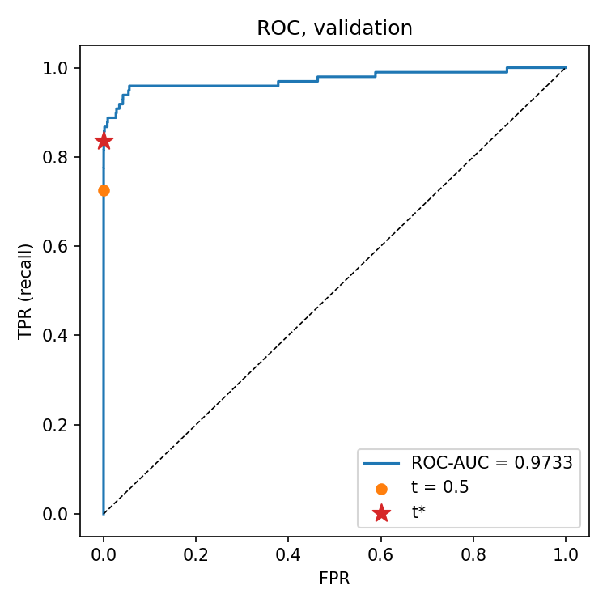
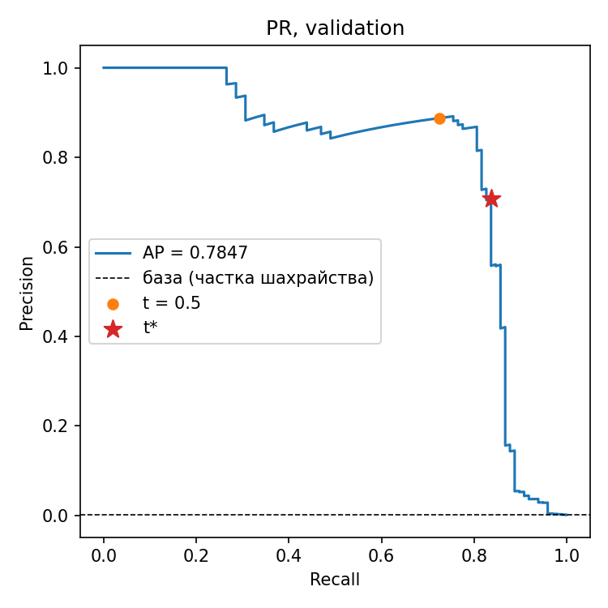

# ЛР2. Поріг рішення під асиметричну ціну помилок

## Запуск
```bash
uv sync
uv run python train.py --csv /шлях/до/creditcard.csv   # навчання → artifacts/
uv run python analyze.py                                # аналіз зі збережених прогнозів → results/
```

## 1. Дані та навчання
Ознаки V1–V28 і Amount; `Class`, `Time` не входять. Поділ 60/20/20, стратифікований, порядок рядків збережено (`test_size=0.4`, потім навпіл; `random_state=0`). `StandardScaler` навчений лише на train. Модель `Linear(29,32)→ReLU→Linear(32,1)`, BCEWithLogitsLoss, Adam (lr=1e-3), 12 епох, пакет 1024, seed 0, ваги після 12-ї епохи.

| Вибірка | Об'єктів | Шахрайств | Частка |
|---|---|---|---|
| train | 170 884 | 295 | 0,1726 % |
| validation | 56 961 | 98 | 0,1720 % |
| test | 56 962 | 99 | 0,1738 % |

Статистики стандартизації не можна рахувати на всьому наборі: середнє й σ із validation/test — витік інформації, через який оцінки стають оптимістичними, а поріг зсунутим.

## 2. Поріг на validation
Прогноз «шахрайство», якщо `s ≥ t`. `precision = TP/(TP+FP)`, `recall = TP/(TP+FN)`, `C(t) = 10·FN + FP`.

**Пошук.** Кандидати: унікальні оцінки та +∞. Оцінки сортуються один раз (`O(n log n)`); для `t` знаходимо `k` — кількість оцінок `< t` (`searchsorted`, `side='left'`). Тоді `TP = P − prefix_pos[k]`, `FP = (n−k) − TP`, `FN = P − TP`, `TN = (n−P) − FP`. Рівні оцінки по один бік від `k`, тож мають однаковий прогноз. При кількох мінімумах `C` береться найбільший поріг.

ROC-AUC = **0,9733**. Висока AUC не гарантує малої вартості чи високої precision: вона оцінює ранжування за всіма порогами, не враховує ціни 10:1, а FPR ділиться на ~57 тис. негативів, тож мала FPR дає багато хибних тривог при ~98 позитивах.

 

Зафіксований поріг **t\* = 0,031194012612104416**. Таблиця кандидатів: `results/validation_candidates.csv`.

| Правило на validation | Поріг | TP | FP | FN | TN | C |
|---|---|---|---|---|---|---|
| Стандартний поріг | 0.5 | 71 | 9 | 27 | 56 854 | 279 |
| Мінімум вартості | t\* | 82 | 34 | 16 | 56 829 | 194 |
| Усі негативні | +∞ | 0 | 0 | 98 | 56 863 | 980 |

## 3. Перевірка пошуку порога
Повільний перебір (`checks.py`) і кумулятивний алгоритм збіглися точно за всіма лічильниками, вартостями й порогами. Набір C: оцінки `[0.8, 0.5×11, 0.2]`, мітки `[1, 1, 0×10, 0]`.

| Набір | t | TP | FP | FN | TN | C |
|---|---|---|---|---|---|---|
| A | 0.1 | 2 | 4 | 0 | 0 | 4 |
| A | 0.2 | 2 | 3 | 0 | 1 | 3 |
| A | **0.4** | 2 | 2 | 0 | 2 | **2** |
| A | 0.7 | 1 | 2 | 1 | 2 | 12 |
| A | 0.9 | 0 | 1 | 2 | 3 | 21 |
| A | +∞ | 0 | 0 | 2 | 4 | 20 |
| B | 0.3 | 0 | 3 | 0 | 0 | 3 |
| B | 0.6 | 0 | 2 | 0 | 1 | 2 |
| B | 0.9 | 0 | 1 | 0 | 2 | 1 |
| B | **+∞** | 0 | 0 | 0 | 3 | **0** |
| C | 0.2 | 2 | 11 | 0 | 0 | 11 |
| C | 0.5 | 2 | 10 | 0 | 1 | 10 |
| C | **0.8** | 1 | 0 | 1 | 11 | **10** |
| C | +∞ | 0 | 0 | 2 | 11 | 20 |

Обрані пороги: A → 0.4, B → +∞, C → 0.8.
- **A:** дві оцінки 0.7 з різними мітками отримують однаковий прогноз.
- **B:** позитивних немає, `C = FP`, мінімум 0 лише при +∞.
- **C:** пороги 0.5 і 0.8 мають однакову `C = 10`; обирається більший, 0.8.

## 4. Test (поріг t\* із validation)
| Правило | TP | FP | FN | TN | C | precision | recall |
|---|---|---|---|---|---|---|---|
| t = 0.5 | 71 | 8 | 28 | 56 855 | 288 | 0,8987 | 0,7172 |
| t\* | 80 | 43 | 19 | 56 820 | 233 | 0,6504 | 0,8081 |

Якщо `TP+FP = 0`, precision не визначена (немає позитивних прогнозів); якщо `TP+FN = 0`, не визначений recall (немає шахрайств).

| Рядок CSV | Тип | Мітка | Оцінка | Amount |
|---|---|---|---|---|
| 460 | FP | 0 | 0,196159 | 2,00 |
| 2961 | FP | 0 | 0,080961 | 2,49 |
| 10783 | FP | 0 | 0,966327 | 89,99 |
| 13405 | FP | 0 | 0,932032 | 89,99 |
| 13617 | FP | 0 | 0,922762 | 89,99 |
| 10497 | FN | 1 | 0,011464 | 3,79 |
| 52521 | FN | 1 | 0,006373 | 105,99 |
| 55401 | FN | 1 | 0,005642 | 1,00 |
| 91671 | FN | 1 | 0,000500 | 290,18 |
| 93486 | FN | 1 | 0,018352 | 0,00 |

Усі FN лежать трохи нижче t\* (оцінки 0,0005–0,018), Amount у них від 0 до 290. Три FP із сумою 89,99 мають оцінки 0,92–0,97, далеко над порогом, два інші близькі до нього. За десятьма прикладами причину помилок судити не можна: це перші за номером рядка, а не випадкова вибірка, вони не мають групи порівняння.

## Висновки
Вибір порога не змінив модель, лише правило рішення: `C` на test знизилась з 288 до 233 (−55). Ціна: FN −9 (економія 90), FP +35, precision впала з 0,90 до 0,65. На validation виграш був більшим (279 → 194, −85), і на test не гарантований: шахрайств лише 98 і 99, а t\* — мінімум із 55 958 кандидатів, підібраний під конкретні оцінки validation.

Код і шаблон README створено за допомогою Claude (Anthropic); результати отримано локальним запуском.
